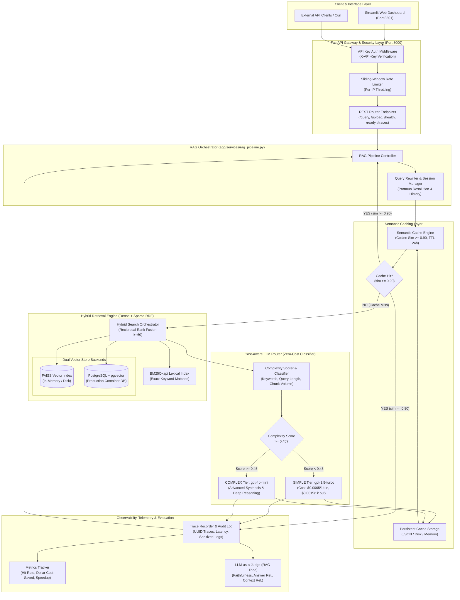

# System Architecture: Semantic Caching & Cost-Aware Routing RAG

## 1. High-Level Architecture Diagram (Mermaid)

---

## 2. End-to-End Request Lifecycle

### Scenario A: Cache Hit (Sub-20ms, $0.00 Inference Cost)
1. **Request Intake**: User submits query via Streamlit or REST API (`POST /api/v1/query`).
2. **Security Gateway**: `rate_limit_middleware` verifies IP request quota; `verify_api_key` verifies `X-API-Key` header (if auth is enabled).
3. **Session Query Rewriting**: If a `session_id` is passed, `QueryRewriter` checks conversational context to resolve pronouns.
4. **Cache Lookup**: `SemanticCache.lookup()` embeds the query using `OpenAIEmbeddings` and computes cosine similarity against cached vectors belonging to the active collection fingerprint (`get_collection_id()`).
5. **Hit Return**: If cosine similarity $\ge 0.90$, the cached answer, citations, and metadata are returned immediately.
6. **Telemetry**: Cache hit, 0 LLM tokens, $0.00 cost, and lookup latency ($< 20\text{ ms}$) are logged to `Tracer` and `MetricsTracker`.

### Scenario B: Cache Miss (Hybrid Retrieval + Cost-Aware Routing)
1. **Cache Miss**: Highest cosine similarity is $< 0.90$.
2. **Hybrid Retrieval**:
   - Dense search retrieves top candidate chunks from vector store (FAISS or PostgreSQL `pgvector`).
   - Sparse search computes BM25Okapi scores across the ingested corpus.
   - **Reciprocal Rank Fusion (RRF)**:
     $$\text{RRF Score}(d) = \frac{0.5}{60 + \text{rank}_{\text{dense}}(d)} + \frac{0.5}{60 + \text{rank}_{\text{sparse}}(d)}$$
   - Deduplicates and sorts candidates, returning top-$k$ contextual chunks.
3. **Cost-Aware Routing**:
   - `llm_router.route()` evaluates query text and chunk count in $< 1\text{ ms}$.
   - Simple queries score $< 0.45$ and route to `gpt-3.5-turbo`.
   - Analytical, multi-part, or comparative queries score $\ge 0.45$ and route to `gpt-4o-mini`.
4. **Grounded Synthesis**: Routed LLM generates answer using prompt instructions requiring strict grounding and source citations in `[Doc: filename, Page X]` format.
5. **Cache Store**: Generated answer and query vector are stored in the semantic cache with 24-hour TTL and collection fingerprint hash.
6. **Telemetry & Tracing**: Detailed execution record with latency, token usage, cost incurred, and sanitized logs is recorded.

---

## 3. Subsystem Specifications

### A. Document Ingestion & Text Processing
- **Module**: `app/services/pdf_loader.py`
- **Extractor**: `pypdf.PdfReader` with defensive validation for zero-byte files, corrupt streams, and empty image scans.
- **Splitter**: `RecursiveCharacterTextSplitter` configured to `chunk_size=800` characters with `chunk_overlap=100`.
- **Metadata Preserved**: File source name, 1-based page number, and chunk index.

### B. Dual Vector Store Architecture
- **Module**: `app/services/vector_store.py`
- **FAISS (Default)**: In-memory `IndexFlatL2` vector index persisted to disk (`faiss_index/index.faiss`). Zero external dependencies, ideal for local development, fast testing, and single-instance deployments.
- **PostgreSQL / pgvector (Production)**: Connection to PostgreSQL database with native `pgvector` extension via `PGVector`. Provides durable, multi-container persistence and concurrent write scalability.
- **Dynamic Invalidation**: SHA-256 fingerprint hash of collection document names and chunk counts (`coll_<hash>`) guarantees that adding or removing documents instantly isolates stale cache entries.

### C. Native BM25 & Hybrid Search
- **Module**: `app/services/bm25.py` and `app/services/hybrid_retriever.py`
- **Tokenizer**: Regex word boundary extractor with case folding and stopword filtering.
- **Scoring**: Standard BM25Okapi with Robertson-Spärck Jones IDF, $k_1=1.5$, and $b=0.75$.
- **Fusion**: Cormack Reciprocal Rank Fusion ($k=60$) combining semantic dense representations with sparse lexical keyword matching.

### D. Zero-Overhead Heuristic Router
- **Module**: `app/services/llm_router.py`
- **Latency**: Sub-millisecond ($< 0.1\text{ ms}$) classification without invoking another LLM.
- **Feature Breakdown**:
  - Keyword density signal ($35\%$): Detects synthesis terms (`compare`, `analyze`, `contrast`, `synthesize`, `evaluate`).
  - Word count signal ($25\%$): Evaluates query length and syntactic complexity.
  - Multi-part question signal ($20\%$): Identifies multiple questions (`?`, `and`, `while`, `versus`).
  - Context chunk volume ($20\%$): Evaluates information density of retrieved evidence chunks.

### E. Security, Throttling & Telemetry
- **Module**: `app/core/security.py`, `app/services/tracing.py`
- **API Key Authentication**: Header-based `X-API-Key` verification with zero-downtime development bypass.
- **Sliding-Window Rate Limiting**: Thread-safe per-IP tracking with configurable quota (default 60 req/min) returning HTTP 429 Too Many Requests.
- **Credential Redaction**: Automated regex pattern scrubbing for OpenAI keys (`sk-...`) and sensitive authentication headers before trace persistence.
- **Readiness Probes**: Dedicated `/ready` and `/health` endpoints for Kubernetes/Docker container lifecycle orchestration.
